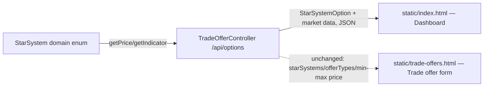

# Player dashboard: live market overview for all six star systems

## 📝 TLDR

Today a player has nowhere to see the market at a glance — the only static page,
`static/index.html`, is a one-system-at-a-time trade-offer form. This proposes a
new dashboard page, built from the existing `design/mockups/index.html` ("Command
Deck") visual shell, that loads real prices and S/D modifiers for all six star
systems from a (lightly extended) `/api/options` endpoint. The dashboard becomes
the app's root page; the trade-offer form moves to its own page, unchanged, so the
capability isn't lost.

## 📝 Problem Statement

`TradeOfferController`/`static/index.html` only ever show one system+good
combination at a time (whatever the form's selects are currently set to). A
player who wants to compare prices and supply/demand across the six systems
(`StarSystem.entries`) before deciding where to trade has no way to do that today
— they'd have to flip the form's selects system by system. The data already
exists in the domain model (`StarSystem.getPrice`/`getIndicator`); it's just never
surfaced as an overview.

## 📝 Proposed Solution

Reuse the existing `/api/options` endpoint and `static/` page pattern rather than
inventing new mechanisms:

- Extend the `StarSystemOption` the endpoint already returns with each system's
  per-good price and S/D modifier, translated from `StarSystem` at the controller
  boundary (engineering-standards.md rule 3). No new endpoint, no new public
  contract beyond one additional field — the trade-offer form's existing
  `fetch('/api/options')` call keeps working unchanged.
- Build one new static page, `static/index.html` (dashboard), using
  `design/mockups/index.html` as the visual reference for the chrome (sidebar,
  topbar, page shell) — but only the chrome: the mocked Star Chart, Fleet Alerts,
  and fleet/warehouse/factory stat tiles are explicitly out of scope (issue
  non-goals) and are dropped, not adapted. In their place: one panel listing all
  6 systems, each showing only the goods it trades with a live price and S/D
  modifier.
- Move the current trade-offer form from `static/index.html` to
  `static/trade-offers.html`, content unchanged beyond its page title and a link
  back to the dashboard — this is what makes the dashboard the new root page
  without deleting the existing capability, and happens to match the "Market"
  nav item the mockup's sidebar already points at `trade-offers.html`.

**Alternative considered:** a new `/api/market` endpoint instead of extending
`/api/options`. Rejected — it would duplicate the system/goods iteration
`/api/options` already does, for no behavioral benefit; one read endpoint for
read-only reference data is simpler to keep consistent.

## 📝 Architecture

No new package or module: this stays inside `trading/adapter/web` (translation
only; `StarSystem` itself is untouched, per engineering-standards.md rule 2 —
domain code doesn't change shape to fit the view) plus one new, one renamed
static HTML file. No cross-system effects — the endpoint is read-only and the
page is unauthenticated, same as today.



Takeaway: one read endpoint now serves both pages; the dashboard is a pure new
consumer, the trade-offer form is an unchanged consumer of the same response
shape plus a path/filename change.

## 📝 Data Model

No persistence or schema change — `StarSystem` stays an in-memory enum. Only the
web DTO shape changes, in `TradeOfferDtos.kt`:

```kotlin
data class GoodsMarket(val goods: Goods, val price: Int, val indicator: Int)

data class StarSystemOption(
    val name: String,
    val displayName: String,
    val goods: List<Goods>,       // unchanged — the trade-offer form keeps using this
    val market: List<GoodsMarket>, // new — one entry per good this system trades
)
```

No sensitive data: prices and S/D modifiers are shared, non-confidential state
per the product brief's R02/domain glossary — nothing here is player-scoped.

## 📝 API Contracts

`GET /api/options` (existing endpoint, extended response) —

```json
{
  "starSystems": [
    {
      "name": "EPSILON_ERIDANI",
      "displayName": "Epsilon Eridani",
      "goods": ["CHIPS", "FOOD", "ISO", "POLY"],
      "market": [
        { "goods": "POLY", "price": 5, "indicator": -7 },
        { "goods": "ISO", "price": 10, "indicator": -7 },
        { "goods": "FOOD", "price": 14, "indicator": -8 },
        { "goods": "CHIPS", "price": 17, "indicator": -9 }
      ]
    }
  ],
  "offerTypes": ["BUY", "SELL"],
  "minPrice": 1,
  "maxPrice": 20
}
```

No request shape changes (`GET`, no params). No validation beyond what already
exists — this is read-only reference data computed from constants.

## 📝 UI/UX

- `static/index.html` (new root/dashboard): sidebar with two real nav entries
  only — **Deck** (this page) and **Market** (`trade-offers.html`); the mockup's
  Fleet/Depots/Industry links are dropped rather than left as dead links, since
  those pages don't exist in this codebase. Topbar keeps the page title only —
  the mockup's Credits/Cycle/avatar chips are fabricated per-player/game state
  that doesn't exist yet (no login, no game session — product brief Scope/Now),
  so they're dropped rather than hardcoded. Main content: one panel, "Market
  Overview", with a card per star system (its display name + a list of its
  goods, each showing price and S/D modifier as plain signed numbers, e.g.
  `POLY — 5 CR · S/D -7`). No color-coded buy/sell interpretation of the
  indicator sign — `SDCalculator` turns it into a recommendation via dice +
  context the dashboard doesn't have, so showing it as a bare fact avoids
  implying an interpretation this ticket doesn't make.
- `static/trade-offers.html` (renamed from today's `index.html`): identical
  form + submitted-offers behavior, just the file name, `<title>`, and one added
  "← Back to Deck" link to `index.html`.
- Fetch pattern: both pages keep the existing `fetch('/api/options')`-then-render
  flow (`loadOptions()` in today's `index.html`); the dashboard reads the new
  `market` field, the trade-offer form keeps reading `goods`/`offerTypes`/min-max
  as it does today.
- No loading-state/animation budget beyond what `trade-offers.html` already has
  (R05/N03 — static, no animation); a brief "Loading market…" placeholder is
  enough while the one fetch resolves.

No mockups/screenshots are attached to this spec's PR: no test-env/browser
provider descriptor is set up in this repo yet (`.ai/scripts` has no
`om-prepare-test-env` output), so this spec is text-only; the implementation PR
should attach real browser screenshots instead once the page exists.

## 📝 Edge Cases & Failure Scenarios

- `/api/options` fails or is slow: both pages already have no error-handling
  beyond letting the fetch promise reject (same as today's `index.html`) — not a
  regression this ticket needs to fix; out of scope.
- A system with only one good (`GAMMA_LEPORIS`, only `POLY`) must still render
  as a one-row card, not be hidden or break the grid — covered by iterating
  `goods`/`market` without assuming a fixed column count.
- Old bookmarks/links to `/` expecting the trade-offer form: this is a breaking
  navigation change (confirmed by the issue author as the intended outcome —
  "this should be the app's root page"); the dashboard links to
  `trade-offers.html` prominently so the form stays one click away.

## 📝 Risks & Impact Review

- **Breaking change, intentional and confirmed:** `GET /` now serves a different
  page than before. This is a pre-launch solo project with no real users yet
  (product brief: "no external users... pre-launch"), and the issue author
  explicitly answered the open question this way — recorded here as a decision,
  not a defect.
- **Response payload growth:** `/api/options` responses grow by the `market`
  array (at most 4 entries per system, 6 systems) — negligible size, no pagination
  or caching concerns at this scale.
- Rollback is trivial: both changes are additive/renaming with no schema or
  persistence involved; reverting the commit restores the old root page.

## 📝 Decisions in play

- R02 (shared vs. confidential state) — relied on: prices/S-D modifiers are
  shared state, safe to expose with no auth, consistent with today's
  `/api/options`.
- R03 (six star systems, four tradable goods) — implemented directly: the
  dashboard renders exactly `StarSystem.entries` and each one's `goods`.
- R05 / N03 (static, lightweight, no animation budget) — relied on: the mockup's
  animated/decorative elements (orbit rings, glow effects on the star chart) are
  dropped, not adapted.
- No product-brief entry is superseded.

## 📋 Phasing

- **Phase 1 — Market data over HTTP:** extend `/api/options` with per-good price
  and S/D modifier; independently shippable and useful (any future client can
  already use it) even before the dashboard page exists.
- **Phase 2 — Dashboard as the root page:** move the trade-offer form to
  `trade-offers.html`, add the new `index.html` dashboard that consumes Phase 1's
  data.

## 📋 Implementation Plan

**Phase 1 — Market data over HTTP**

1. Add `GoodsMarket(goods, price, indicator)` and a `market: List<GoodsMarket>`
   field on `StarSystemOption` in `TradeOfferDtos.kt`; populate it in
   `TradeOfferController.options()` from `StarSystem.getPrice`/`getIndicator` for
   each of the system's `goods`, sorted the same way `goods` already is.
   Extend `TradeOfferControllerTest.shouldExposeOptionsForBuildingTheForm` (or add
   a new test) asserting `EPSILON_ERIDANI`'s `market` entries match
   `StarSystem.EPSILON_ERIDANI.getPrice`/`getIndicator` for all four of its goods.
   App stays fully working: this only adds a field existing consumers ignore.

**Phase 2 — Dashboard as the root page**

2. Rename today's `static/index.html` to `static/trade-offers.html` (content
   unchanged except `<title>` and an added back-link to `index.html`). Add a new
   `static/index.html`: sidebar (Deck/Market nav only) + topbar (title only) +
   a "Market Overview" panel that fetches `/api/options` once and renders a card
   per star system with its goods' price + S/D modifier, styled consistently
   with `trade-offers.html`'s existing inlined dark theme (reuse its CSS custom
   properties rather than pulling in the mockup's full `shared.css`). Manually
   verify in a browser: loading `/` shows all 6 systems with correct live values,
   and the Market link reaches the working trade-offer form. App stays fully
   working end-to-end; this is the last step.
